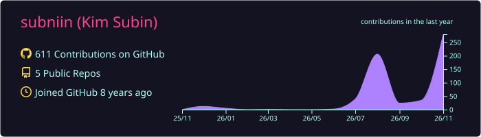
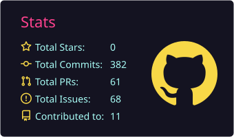
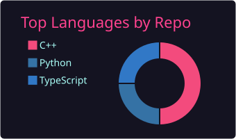

## 안녕하세요, **Kim Subin**입니다.

공개 데이터와 LLM으로 실제 문제를 푸는 프로젝트를 만듭니다. 국내 경제 뉴스를 요약해 산업 테마로 묶는 **Stocker**, 버스 정류장의 대기 인원을 공개 데이터로 추정하는 **Station Cast**를 팀으로 만들었고, Claude Code의 "다 했어요"를 검증하는 플러그인 **harness**(AH_)를 만들고 있습니다.

---

## About me

- 모델이 한 말이 아니라 **실제로 돌려 본 결과**를 근거로 삼아요.
- 확인하지 못한 것은 **확인하지 못했다고** 적어요.
- 팀 프로젝트에서는 `MMM`, `Multi-Bus` 조직에서 함께 작업해요.

---

## ⚡ Technologies

#### 🧠 AI & Data

  
  
  
  

#### 🌐 Web & Backend

  
  
  
  
  
  

---

## 🚀 Projects

| 프로젝트 | 무엇을 | 보기 |
|---|---|---|
| **Stocker** | 국내 경제 뉴스를 수집하고 Gemini로 요약해 WICS 산업 테마를 붙이는 뉴스 파이프라인 (Airflow · Supabase) |  |
| **Station Cast** | 승차 데이터와 배차간격으로 정류장 대기 인원을 추정하는 오픈소스 서비스 — 2026 오픈소스 개발자대회 출품작, 팀 Multi-Bus (FastAPI · React) |  |
| **harness** | 테스트와 검사를 통과해야 작업을 끝으로 치는 Claude Code 플러그인 (Node) |  |

---

  

  
  

  

