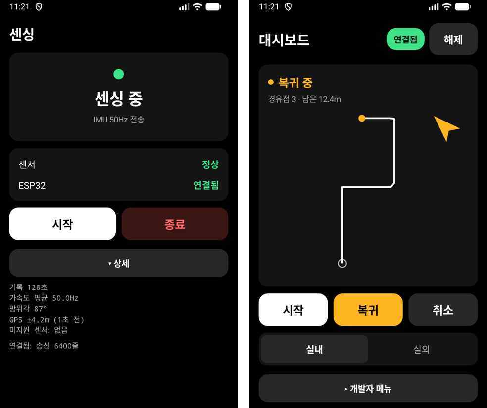

<h1 align="center">김수빈</h1>

  테스트와 기록으로 <b>다시 확인하는</b> 개발자 
  동국대학교 컴퓨터·AI학부

  

---

## Tech

  
  
  
  
  
  
  
  
  
  
  
  
  
  

---

## Projects

| 프로젝트 | 내용 | 역할 | 상태 | 링크 |
|---|---|---|---|---|
| **다수 드론 편대 제어** | 실내에서 드론 6대가 충돌 없이 이동하는 경량 제어 (종합설계) | 시뮬레이션, 기체 시험, 알고리즘, UWB, BLE |  | [Repo](https://github.com/Multi-Bus/capstone_design) |
| **Come Back Home** | 허리 진동 모터 8개로 구조대원의 복귀 방향을 알려 주는 장치 | 안드로이드 앱, BLE 연결 |  | [Repo](https://github.com/subniin/come-back-home) |
| **Tokk** | 짧은 소리에 웹앱이 반응하는 엔진, Kiro로 개발 | 작업 지시, 결과 확인 |  | [Repo](https://github.com/subniin/tokk) · [Demo](https://subniin.github.io/tokk/) |
| **공시 질의응답 Agent** | 공시·재무 데이터로 답하는 Agent (미래에셋 AI Festival) | 팀장, 검증기 |  |  |
| **AI 코딩 하네스** | 검사 결과로 AI 작업 완료를 판정하는 Claude Code 플러그인 | 설계, 명세, 검토 |  |  |
| **Station Cast** | 승차 데이터로 정류장 대기 인원을 추정 (오픈소스 개발자대회) | 팀장, CI |  | [Repo](https://github.com/Multi-Bus/station-cast) |
| **Stocker** | 경제 뉴스 수집·요약·산업 테마 분류 파이프라인 | | | [Repo](https://github.com/mmm-labs-kr/stocker-news-crawling-system) |

---

## Featured

<table>
  <tr>
    <td width="50%" valign="top">
      
       <b>다수 드론 편대 제어</b>
       UWB 위치 · BLE 통신 · CBF-QP 충돌 회피
       시뮬레이션과 호버링 시험 완료, 다수 기체 비행은 진행 중
    </td>
    <td width="50%" valign="top">
      
       <b>Come Back Home</b>
       폰 센서 → BLE → ESP32 → 허리 진동 모터 8개
       경로 기록과 복귀 진동 시험 완료, 알고리즘 수정 중
    </td>
  </tr>
  <tr>
    <td width="50%" valign="top">
      
       <b>Tokk</b>
       스펙 → Kiro 구현 → 자동 검사 → 직접 확인
       앱 3개 배포, 실마이크 10/10
    </td>
    <td width="50%" valign="top">
      <b>AI 활용 방식</b>
      <ul>
        <li>작업 단위 스펙 36개로 나눠 Kiro에 구현</li>
        <li>저장 시 훅 5개가 자동 검사</li>
        <li>MCP 서버로 AI가 소리를 듣고 점수를 확인</li>
        <li>검사 결과로 완료를 판정하는 플러그인 (하네스)</li>
      </ul>
    </td>
  </tr>
</table>
